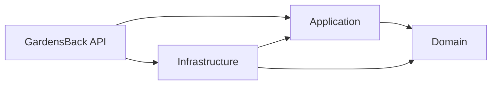
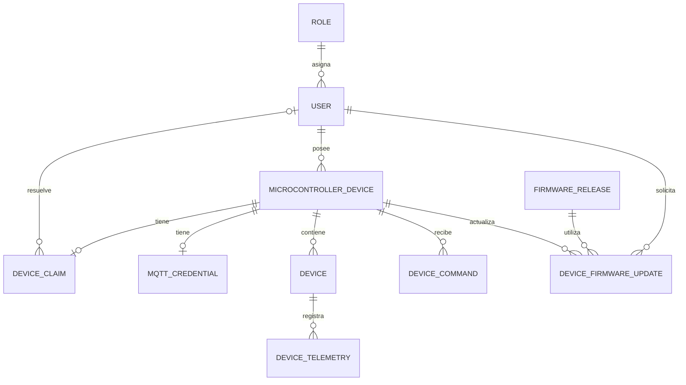
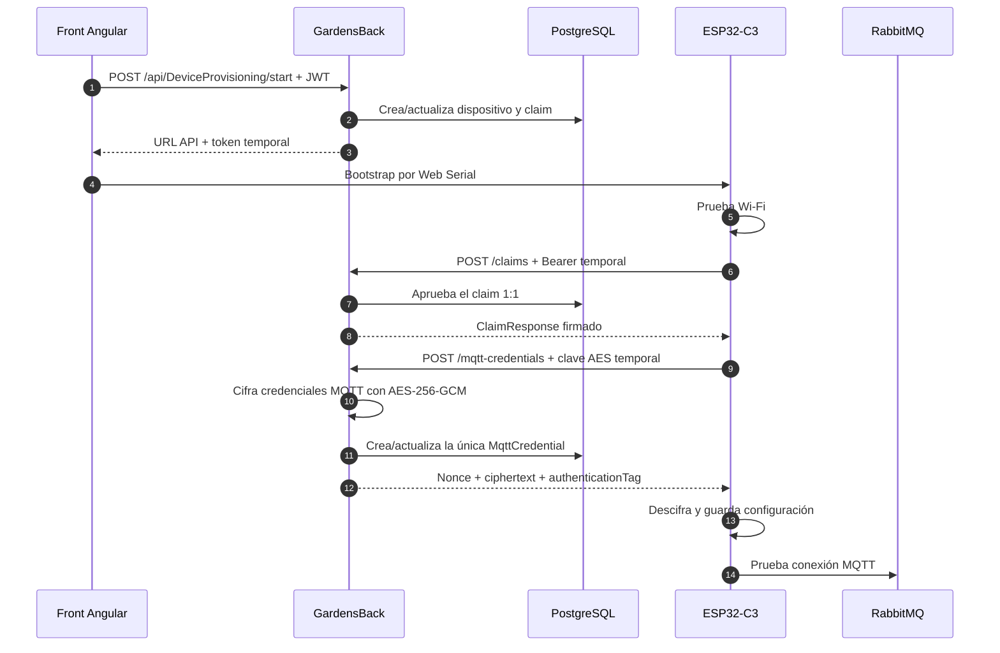

# GardensBack

Backend de la huerta automatizada. Expone autenticación, administración básica de
usuarios y roles, configuración de conectividad para dispositivos y el flujo de
aprovisionamiento de un ESP32-C3 hasta la entrega cifrada de credenciales MQTT.

> Estado del documento: 29 de octubre de 2026.

## Estado actual

Actualmente están implementados:

- autenticación JWT;
- validación de usuario, rol, estado y versión del token en cada solicitud;
- módulo básico de usuarios y roles;
- PostgreSQL mediante Entity Framework Core;
- migraciones automáticas al iniciar mediante Docker;
- configuración global de la dirección de API y RabbitMQ anunciada a los ESP;
- registro o actualización de un `MicrocontrollerDevice`;
- claim 1:1 entre `MicrocontrollerDevice` y `DeviceClaim`;
- emisión de un token temporal de aprovisionamiento;
- entrega idempotente del resultado del claim;
- relación 1:1 entre `MicrocontrollerDevice` y `MqttCredential`;
- entrega de credenciales MQTT mediante AES-256-GCM;
- persistencia del sobre cifrado para reintentos de la misma solicitud;
- Swagger/OpenAPI;
- health check de PostgreSQL y migraciones;
- imagen Docker Linux para la API.

El flujo fue probado con el front Angular mínimo y un ESP32-C3 físico:

```text
wifi: completed
claim: completed
mqtt_credentials: in_progress
mqtt: in_progress
mqtt: completed
```

## Tecnologías

- .NET 10 / ASP.NET Core
- Entity Framework Core 10
- PostgreSQL 17
- Npgsql
- JWT Bearer
- AutoMapper
- Swagger / OpenAPI
- AES-256-GCM para credenciales MQTT
- Docker
- RabbitMQ con plugin MQTT, administrado desde la infraestructura del proyecto

## Arquitectura

La solución sigue una separación tipo Clean Architecture:

```text
GardensBack
├── GardensBack                 API, controladores, middleware y composición
├── GardensBack.Application     servicios, DTO, contratos y casos de uso
├── GardensBack.Domain          entidades, enumeraciones y constantes de dominio
└── GardensBack.Infrastructure  EF Core, repositorios, seguridad y migraciones
```

Dependencias principales:



El dominio no depende de la API. Application declara las abstracciones e
Infrastructure las implementa.

## Modelo relevante



`DeviceConnectivityConfiguration` es una configuración global independiente,
identificada por `ConfigurationKey = "default"`.

Las relaciones de claim y credencial MQTT son deliberadamente 1:1. Los reintentos
y rotaciones reutilizan la misma fila; no se crean historiales por cada intento.

## Flujo de aprovisionamiento



El JWT del usuario nunca se entrega al ESP. El dispositivo utiliza un token
temporal cuyo hash queda en PostgreSQL. Las credenciales MQTT no pasan por el
front.

## API disponible

Todas las rutas están bajo `/api`. Existe una política global que exige un JWT
válido, excepto en los endpoints marcados como anónimos.

### Autenticación

| Método | Ruta | Autorización | Descripción |
|---|---|---|---|
| `POST` | `/api/Auth/Login` | Anónimo | Autentica al usuario y entrega el JWT. |

### Usuarios

| Método | Ruta | Autorización | Descripción |
|---|---|---|---|
| `POST` | `/api/User/Register` | Anónimo | Registro básico de usuario. |
| `POST` | `/api/User/CreateUser` | Administrador | Crea un usuario. |
| `POST` | `/api/User/CreateUserMiddleware` | Administrador | Variante que utiliza la abstracción de persistencia existente. |
| `PUT` | `/api/User/UpdateUser` | JWT | Actualiza usando el ID incluido en el objeto. |
| `DELETE` | `/api/User/DeleteUser/{id}` | JWT | Desactiva/elimina lógicamente un usuario. |
| `GET` | `/api/User/GetUserById/{id}` | JWT | Consulta un usuario por ID. |
| `GET` | `/api/User/GetUserByEmail?email=` | JWT | Consulta por correo. |
| `GET` | `/api/User/GetAllUsers` | Administrador | Lista usuarios y permite filtrar por rol. |

Los métodos actuales de usuarios utilizan `OperationResult<T>`. El flujo de
aprovisionamiento devuelve DTO directos.

### Roles

| Método | Ruta | Autorización | Descripción |
|---|---|---|---|
| `POST` | `/api/Roles/CreateRole` | Administrador | Crea un rol. |
| `GET` | `/api/Roles/FindByName?name=` | JWT | Busca por nombre. |
| `GET` | `/api/Roles/GetAllRoles?active=` | JWT | Lista roles, opcionalmente por estado. |
| `PUT` | `/api/Roles/UpdateRole` | Administrador | Actualiza un rol. |

### Configuración de conectividad

| Método | Ruta | Autorización | Descripción |
|---|---|---|---|
| `GET` | `/api/DeviceConnectivityConfiguration` | Administrador | Consulta la configuración global. |
| `PUT` | `/api/DeviceConnectivityConfiguration` | Administrador | Crea o actualiza el registro `default`. |

Esta configuración contiene:

- host, puerto y uso de TLS de la API accesible desde el ESP;
- host, puerto y uso de TLS de MQTT accesible desde el ESP.

No debe configurarse `localhost`, `127.0.0.1`, `0.0.0.0` ni
`host.docker.internal` como dirección anunciada al dispositivo.

### Aprovisionamiento de dispositivos

| Método | Ruta | Autorización | Descripción |
|---|---|---|---|
| `POST` | `/api/DeviceProvisioning/start` | JWT | Crea/reinicia el aprovisionamiento y devuelve el bootstrap temporal. |
| `POST` | `/api/DeviceProvisioning/claims` | Bearer temporal | Registra y aprueba el claim del ESP. |
| `GET` | `/api/DeviceProvisioning/claims/{requestId}` | Bearer temporal | Recupera el resultado idempotente del claim. |
| `POST` | `/api/DeviceProvisioning/mqtt-credentials` | Bearer temporal | Genera y cifra el sobre MQTT. |
| `GET` | `/api/DeviceProvisioning/mqtt-credentials/{requestId}` | Bearer temporal | Recupera el mismo sobre cifrado. |

Los GET de claim y credenciales permiten polling/recuperación. En el recorrido
sincrónico actual los POST responden directamente con `200 OK`.

### Diagnóstico

| Método | Ruta | Autorización | Descripción |
|---|---|---|---|
| `GET` | `/health` | Anónimo | Comprueba acceso a PostgreSQL y migraciones pendientes. |
| `GET` | `/swagger` | Anónimo | Interfaz Swagger. |
| `GET` | `/swagger/v1/swagger.json` | Anónimo | Contrato OpenAPI generado. |

## Configuración

Las secciones relevantes son:

```json
{
  "ConnectionStrings": {
    "DefaultConnection": "..."
  },
  "Database": {
    "InitializeOnStartup": false
  },
  "Jwt": {
    "Issuer": "GardensBack",
    "Audience": "GardensWeb",
    "SigningKey": "...",
    "ExpirationMinutes": 60
  },
  "RabbitMQ": {
    "Host": "127.0.0.1",
    "Port": 5673,
    "Username": "...",
    "Password": "..."
  },
  "DeviceProvisioning": {
    "TokenExpirationMinutes": 10
  }
}
```

No deben confirmarse secretos reales en Git. Para Docker se utilizan variables
con la notación de configuración de ASP.NET Core:

```text
ConnectionStrings__DefaultConnection
Jwt__Issuer
Jwt__Audience
Jwt__SigningKey
Jwt__ExpirationMinutes
RabbitMQ__Host
RabbitMQ__Port
RabbitMQ__Username
RabbitMQ__Password
DeviceProvisioning__TokenExpirationMinutes
Database__InitializeOnStartup
```

### Diferencia entre RabbitMQ interno y MQTT anunciado

`RabbitMQ:Host` y `RabbitMQ:Port` describen cómo el backend encuentra al broker.
Dentro del compose normalmente son `rabbitmq:5672`.

El ESP no puede utilizar esa dirección interna. Recibe `MqttHost` y `MqttPort`
desde `DeviceConnectivityConfiguration`, por ejemplo la IP LAN del host y el
puerto MQTT publicado `1884`.

Actualmente el backend entrega al ESP el usuario y contraseña configurados en la
sección `RabbitMQ`. La fila `MqttCredential` es individual por dispositivo, pero
el broker todavía utiliza la credencial compartida configurada por entorno. La
creación de usuarios independientes en RabbitMQ queda como evolución posterior.

## Ejecución local

### Requisitos

- .NET SDK 10
- PostgreSQL accesible con la cadena configurada
- RabbitMQ si se probará el flujo MQTT
- certificado HTTPS de desarrollo de ASP.NET Core

### Restaurar y compilar

```powershell
dotnet restore .\GardensBack\GardensBack.csproj
dotnet build .\GardensBack\GardensBack.csproj
```

### Aplicar migraciones manualmente

Desde la raíz del repositorio:

```powershell
dotnet ef database update `
  --project .\GardensBack.Infrastructure\GardensBack.Infrastructure.csproj `
  --startup-project .\GardensBack.Infrastructure\GardensBack.Infrastructure.csproj `
  --context ApplicationDbContext
```

Desde la consola de NuGet de Visual Studio:

```powershell
Update-Database -Project GardensBack.Infrastructure -StartupProject GardensBack.Infrastructure -Context ApplicationDbContext
```

### Iniciar la API

```powershell
dotnet run --project .\GardensBack\GardensBack.csproj --launch-profile https
```

Direcciones locales:

- HTTPS: `https://localhost:7240`
- HTTP: `http://localhost:5239`
- Swagger: `https://localhost:7240/swagger`

Estas direcciones `localhost` sirven para navegador/Postman en el mismo PC, pero
no son accesibles desde el ESP.

## Ejecución con Docker

El `Dockerfile` está en `GardensBack/Dockerfile`. El compose principal se mantiene
en la carpeta de infraestructura del proyecto general, fuera de este repositorio.

Desde esa carpeta:

```powershell
docker compose up -d --build gardens-back
```

El entorno actual publica la API en:

```text
http://127.0.0.1:8080   Navegador/front local
http://IP_LAN:8080      ESP dentro de la red local
```

Con `Database__InitializeOnStartup=true`, la API aplica las migraciones pendientes
antes de aceptar tráfico.

Comandos de diagnóstico:

```powershell
docker compose ps
docker compose logs -f gardens-back
docker compose logs -f postgres
docker compose logs -f rabbitmq
```

## Seguridad del aprovisionamiento

- El token temporal se genera con aleatoriedad criptográfica.
- PostgreSQL almacena el hash, no el token original.
- El token tiene expiración y se consume al guardar el sobre MQTT.
- Reintentos con el mismo `requestId` reciben la respuesta previamente guardada.
- La clave AES de 256 bits la genera el ESP.
- El backend no persiste la clave AES.
- Las credenciales se cifran mediante AES-256-GCM con nonce y AAD.
- La contraseña MQTT no pasa por Angular.
- JWT, token temporal, clave AES y contraseñas no deben escribirse en logs.
- El uso de HTTP por el ESP queda limitado a pruebas locales controladas; el
  despliegue definitivo debe usar HTTPS con una CA confiable para el firmware.

## Estado pendiente

El recorrido físico hasta `mqtt: completed` funciona, pero todavía falta cerrar el
estado final en el backend:

- el ESP emite `device_configuration_result` por serial;
- el front lo muestra, pero aún no lo reporta a la API;
- `MqttCredential` permanece en estado `Testing`;
- `MicrocontrollerDevice` todavía no cambia a `Provisioned` mediante una
  confirmación final.

También están pendientes, como módulos de aplicación/API:

- recepción y persistencia de telemetría real;
- publicación y confirmación de comandos;
- inventario administrado de sensores y actuadores;
- administración de credenciales RabbitMQ independientes por dispositivo;
- flujo OTA completo desde el backend;
- recuperación, desvinculación y revocación administradas desde la API;
- pruebas automatizadas del backend.

Las entidades de telemetría, comandos y firmware ya existen, pero esto no implica
que sus controladores y servicios estén implementados.

## Notas de desarrollo

- Los controladores utilizan rutas `api/[controller]`. Por eso el firmware debe
  llamar exactamente `/api/DeviceProvisioning/...`, sin insertar guiones.
- La configuración global del ESP sale de PostgreSQL; no debe inferirse de la URL
  usada por el navegador.
- `DeviceClaim` y `MqttCredential` se reutilizan por dispositivo.
- Para renovar credenciales se actualiza la misma fila y aumenta `Version`.
- El middleware HTTP global transforma excepciones de aplicación en
  `ProblemDetails`.
- La abstracción de persistencia basada en `UnitOfWork` continúa disponible para
  los módulos que la utilizan, pero el aprovisionamiento opera con DTO directos y
  `SaveChanges` en su repositorio específico.

