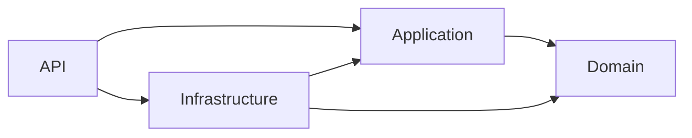

# Gardens Back

API y servicios de integración de la plataforma Huerta. Administra usuarios, dispositivos, aprovisionamiento, inventario, telemetría, comandos y actualizaciones de firmware para microcontroladores ESP32-C3.

## Tecnologías

- .NET 10 y ASP.NET Core.
- Entity Framework Core 10.
- PostgreSQL 17 mediante Npgsql.
- RabbitMQ con transporte MQTT.
- SignalR para telemetría en tiempo real.
- JWT Bearer para autenticación.
- Swagger/OpenAPI.
- Docker Linux.

## Funcionalidades

- Autenticación JWT y validación de usuarios activos.
- Administración de usuarios y roles.
- Configuración de conectividad anunciada a los dispositivos.
- Aprovisionamiento, claim y factory reset de microcontroladores.
- Entrega cifrada y rotación de credenciales MQTT.
- Recepción y persistencia del inventario publicado por el firmware.
- Recepción, consulta y publicación en tiempo real de telemetría.
- Envío de comandos a sensores y actuadores.
- Correlación de respuestas y expiración de comandos pendientes.
- Registro, publicación, revocación y distribución de releases OTA.
- Seguimiento del estado de actualización de firmware.
- Health checks y aplicación opcional de migraciones al iniciar.

## Arquitectura

La solución mantiene una separación inspirada en Clean Architecture:

```text
GardensBack.slnx
├── GardensBack/                 API, controladores, middleware y SignalR
├── GardensBack.Application/     Casos de uso, DTO y abstracciones
├── GardensBack.Domain/          Entidades, enums y reglas de dominio
└── GardensBack.Infrastructure/  EF Core, MQTT, seguridad y migraciones
```

Dependencias principales:



Los consumidores MQTT se ejecutan como servicios en segundo plano:

- `MqttInventoryConsumer`.
- `MqttTelemetryConsumer`.
- `MqttDeviceActionResponseConsumer`.
- `MqttFirmwareUpdateStatusConsumer`.
- `DeviceCommandExpirationWorker`.

## Flujo general

```text
Front Angular ──HTTP/JWT──> GardensBack ──EF Core──> PostgreSQL
      │                          │
      │ Web Serial               ├──MQTT──> RabbitMQ
      ▼                          │             │
   ESP32-C3 <──────── control, actions, telemetry e inventario
      │
      └──SignalR──> GardensBack ──> Front Angular
```

El JWT del usuario no se entrega al ESP. Durante el aprovisionamiento se utiliza un token temporal específico cuyo hash se almacena en la base de datos.

## Requisitos

- .NET SDK 10.
- PostgreSQL accesible.
- RabbitMQ con el plugin MQTT habilitado.
- Docker Desktop, opcional pero recomendado para el entorno completo.
- Herramientas de Entity Framework para administrar migraciones manualmente.

Instalación de `dotnet-ef` si no está disponible:

```powershell
dotnet tool install --global dotnet-ef
```

## Configuración

Las opciones principales se pueden definir con `appsettings.Development.json`, User Secrets o variables de entorno.

| Sección | Propósito |
|---|---|
| `ConnectionStrings:DefaultConnection` | Conexión a PostgreSQL |
| `Database:InitializeOnStartup` | Aplicación automática de migraciones |
| `Jwt` | Emisor, audiencia, clave y expiración |
| `RabbitMQ` | Broker MQTT y nombres de consumidores |
| `DeviceProvisioning` | Expiración de tokens temporales |
| `DeviceCommandSecurity` | Protección de claves de comandos |
| `DeviceCommandExpiration` | Frecuencia de expiración de comandos |
| `FirmwareReleaseValidation` | Clave pública y límites de artifacts OTA |
| `FirmwareUpdate` | Expiración de órdenes OTA |

ASP.NET Core traduce `:` a `__` en variables de entorno:

```text
ConnectionStrings__DefaultConnection
Database__InitializeOnStartup
Jwt__Issuer
Jwt__Audience
Jwt__SigningKey
Jwt__ExpirationMinutes
RabbitMQ__Host
RabbitMQ__MqttPort
RabbitMQ__Username
RabbitMQ__Password
RabbitMQ__InventoryConsumerClientId
RabbitMQ__FirmwareStatusConsumerClientId
RabbitMQ__TelemetryConsumerClientId
RabbitMQ__ActionResponseConsumerClientId
DeviceProvisioning__TokenExpirationMinutes
DeviceCommandSecurity__EncryptionKey
DeviceCommandExpiration__SweepIntervalSeconds
FirmwareReleaseValidation__PublicKeyPem
FirmwareReleaseValidation__AllowHttp
FirmwareUpdate__CommandExpirationMinutes
```

No se deben confirmar contraseñas, claves JWT ni claves de cifrado reales en Git. Para desarrollo local se pueden usar User Secrets:

```powershell
dotnet user-secrets set "ConnectionStrings:DefaultConnection" "<connection-string>" --project .\GardensBack
dotnet user-secrets set "Jwt:SigningKey" "<signing-key>" --project .\GardensBack
dotnet user-secrets set "RabbitMQ:Password" "<password>" --project .\GardensBack
dotnet user-secrets set "DeviceCommandSecurity:EncryptionKey" "<base64-32-bytes>" --project .\GardensBack
```

## Restaurar y compilar

Desde la raíz del repositorio:

```powershell
dotnet restore .\GardensBack.slnx
dotnet build .\GardensBack.slnx
```

## Base de datos

Las migraciones se encuentran en `GardensBack.Infrastructure/Persistance/Migrations`.

Aplicarlas manualmente:

```powershell
dotnet ef database update `
  --project .\GardensBack.Infrastructure\GardensBack.Infrastructure.csproj `
  --startup-project .\GardensBack.Infrastructure\GardensBack.Infrastructure.csproj `
  --context ApplicationDbContext
```

En Docker se puede establecer:

```text
Database__InitializeOnStartup=true
```

La API comprobará que existan migraciones y las aplicará antes de aceptar tráfico.

## Ejecución local

```powershell
dotnet run --project .\GardensBack\GardensBack.csproj --launch-profile https
```

Direcciones predeterminadas:

| Recurso | URL |
|---|---|
| API HTTP | `http://localhost:5239` |
| API HTTPS | `https://localhost:7240` |
| Swagger | `https://localhost:7240/swagger` |
| Health check | `https://localhost:7240/health` |
| SignalR | `/hubs/telemetry` |

## API

Todos los controladores se publican bajo `/api`. Los grupos principales son:

| Grupo | Responsabilidad |
|---|---|
| `/api/Auth` | Inicio de sesión |
| `/api/User` | Usuarios y perfil |
| `/api/Roles` | Roles y permisos |
| `/api/DeviceConnectivityConfiguration` | Direcciones anunciadas al firmware |
| `/api/DeviceProvisioning` | Start, claim, credenciales y factory reset |
| `/api/DeviceInventory` | Inventario, telemetría y comandos |
| `/api/FirmwareReleases` | Administración de releases |
| `/api/FirmwareManifest` | Manifiesto y artifact del firmware |
| `/api/DeviceFirmwareUpdates` | Solicitud y seguimiento de OTA |

El detalle actualizado de rutas, cuerpos y respuestas está disponible en Swagger.

## Docker

El `Dockerfile` se encuentra en `GardensBack/Dockerfile`. El entorno completo se administra desde el repositorio de infraestructura del proyecto Huerta.

Desde la carpeta que contiene `compose.yaml`:

```powershell
docker compose up -d --build gardens-back
```

Diagnóstico:

```powershell
docker compose ps
docker compose logs -f gardens-back
docker compose logs -f postgres
docker compose logs -f rabbitmq
```

Dentro de Compose, la API escucha en el puerto `8080` y utiliza los nombres de servicio `postgres` y `rabbitmq`.

## Seguridad

- Autenticación JWT para usuarios y SignalR.
- Tokens temporales de aprovisionamiento almacenados mediante hash.
- Credenciales MQTT entregadas al ESP mediante AES-256-GCM.
- Autenticación de claims y comandos por dispositivo.
- Protección de material criptográfico almacenado por la aplicación.
- Releases OTA validadas mediante clave pública, hash, tamaño y compatibilidad.
- Respuestas HTTP de error normalizadas mediante `ProblemDetails`.
- Los secretos no deben registrarse en logs ni incluirse en el repositorio.
- `AllowHttp` debe deshabilitarse en un entorno productivo.

## Pruebas y verificación

Actualmente el repositorio no contiene un proyecto de pruebas automatizadas independiente. Antes de integrar cambios se recomienda:

```powershell
dotnet restore .\GardensBack.slnx
dotnet build .\GardensBack.slnx --configuration Release
```

Además, validar:

- `/health` para PostgreSQL y migraciones.
- Swagger para contratos HTTP.
- Logs de los consumidores MQTT.
- Flujo completo front → API → RabbitMQ → ESP.
- Publicación SignalR después de recibir telemetría.

## Convenciones de desarrollo

- Las reglas de negocio deben permanecer fuera de los controladores.
- Application define contratos; Infrastructure implementa persistencia y mensajería.
- Los DTO públicos deben mantenerse sincronizados con el front y el firmware.
- Las fechas intercambiadas por la API se manejan en UTC.
- Las operaciones MQTT deben conservar `deviceId` y `requestId` para correlación.
- Las nuevas entidades requieren configuración EF Core y migración correspondiente.

## Documentación para GitHub Pages

La documentación visual del backend se encuentra en [`index.html`](index.html). Es una página estática y autocontenida, con sus imágenes en [`site-assets/`](site-assets/), preparada para publicarse desde la raíz del repositorio mediante GitHub Pages.

Para revisarla localmente:

```powershell
python -m http.server 4175
```

Luego abre `http://localhost:4175` en el navegador.
